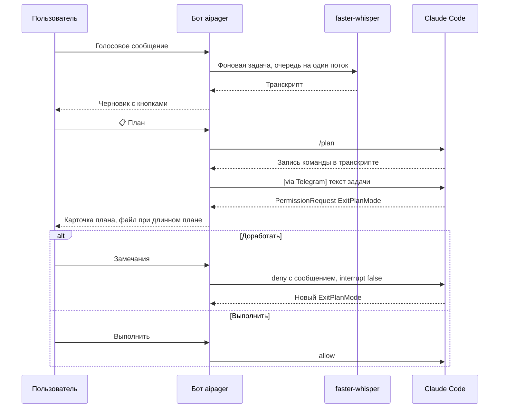
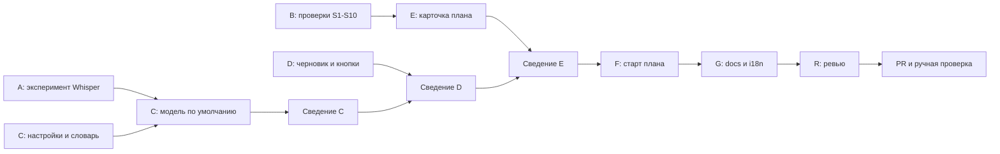

# Голосовое сообщение в план работ

Статус: черновик. Разработка не начата. Часть фактов требует проверки на живой сессии: см. раздел
«Проверки до разработки».

## Цель

Пользователь наговаривает задачу боту в Telegram. Активная сессия Claude Code строит по этой задаче план работ.
Пользователь читает план на телефоне, просит доработать его текстом или голосом и запускает выполнение.

Сейчас голосовое сообщение сразу уходит в сессию как обычный промпт. Распознанный текст нельзя проверить до
отправки, а план из `ExitPlanMode` не виден в Telegram.

## Исходные факты

| Факт | Источник | Следствие |
|---|---|---|
| Голос уже распознаётся локально через faster-whisper | `aipager/bot/voice.py` | Новый сервис распознавания не нужен |
| Модель по умолчанию `base` | `aipager/bot/voice.py:36` | Для русской речи с терминами нужна модель сильнее |
| В Messages API нет блока `audio` | Документация Claude API, 2026-10-30 | Anthropic SDK не участвует, API-ключ не нужен |
| `/plan [описание]` входит в plan mode | Документация Claude Code | Подходит только голая форма `/plan`, см. ниже |
| Текст с `/` уходит без маркера `[via Telegram]` | `aipager/bot/session_ops.py:1339` | Хук считает такой промпт терминальным |
| `ExitPlanMode` в aipager не обрабатывается | `aipager/dtach/hook_receiver.py:631` | Нужна новая карточка плана |
| Хук ждёт ответ 20 с, затем `allow` нажимает Enter | `aipager/dtach/notify_hook.py:107` | Нажатие может сменить режим сессии |
| Ответ хуку читается в буфер 8192 байта | `aipager/dtach/hook_reply.py:158` | Около 1300 кириллических символов ломают ответ |
| Транскрипция ждётся в обработчике | `aipager/bot/handlers.py:2679` | Бот не отвечает, пока идёт распознавание |

## Критерии приёмки

1. Голосовое сообщение не попадает в сессию до нажатия кнопки.
2. Карточка показывает распознанный текст и кнопки `📋 План`, `▶️ Как промпт`, `✏️ Исправить`, `❌ Отмена`.
3. Голосовое имя для `/new` и для переименования работает без кнопок, как сейчас.
4. Несколько голосовых сообщений подряд собираются в один черновик по порядку отправки.
5. Кнопка `✏️ Исправить` принимает текст или голос и обновляет черновик.
6. Кнопка `📋 План` переводит сессию в plan mode и только после подтверждения отправляет текст с маркером.
7. Если сессия занята, старт плана ждёт конца хода и очереди.
8. Если вход в plan mode не подтверждён, в сессию ничего не уходит, черновик сохраняется, пользователь видит причину.
9. Карточка плана показывает текст плана и кнопки `Выполнить` и `Доработать`.
10. План длиннее лимита Telegram приходит ещё и файлом `plan-<session>.md`. Сбой файла не теряет карточку.
11. `Доработать` принимает текст или голос до 2000 кириллических символов. Claude получает замечания и присылает новый план.
12. `Выполнить` возвращает сессию в прежний режим. Карточка показывает этот режим.
13. Ответ на план никогда не нажимает клавиши в сессии.
14. Распознавание не блокирует другие команды и нажатия, включая Stop.
15. Модель Whisper выбрана по эксперименту на голосе владельца, числа записаны в этой странице.
16. Словарь терминов читается только из локальных файлов. В репозитории нет данных компании.
17. Весь новый текст для людей проходит через `Msg` и `tr`. Текст для Claude не переводится.
18. Полный набор тестов проходит и держится ниже 5000 тестов. Каждая защита проверена поломкой.

## Вне рамок

- Облачное распознавание и вызовы Claude API из демона.
- Аудиофайлы и видеосообщения. Первая версия принимает только `msg.voice`.
- Хранение черновиков после рестарта демона.
- Ответ голосом от бота.
- Изменение других карточек разрешений.

## Контракты

### Сценарий



### Настройки

Новый блок в `~/.config/aipager/aipager.yaml`. Читается лениво, как в `aipager/bot/menu.py:83-90`. Файл
`aipager/config.py` не меняется: он входит в цепочку импортов хука. Приоритет: окружение, затем yaml, затем значение
по умолчанию. `AIPAGER_WHISPER_MODEL` остаётся и имеет приоритет.

```yaml
voice:
  model: <итог эксперимента>
  language: ru
  vad_filter: true
  cpu_threads: 0
  beam_size: 1
  glossary_file: ~/.config/aipager/voice-glossary.txt
  glossary_sources:
    - /path/to/local/standards
```

Значения `cpu_threads`, `beam_size` и `vad_filter` выше являются примером: итог задаёт эксперимент.

### Словарь

Файл `voice-glossary.txt` содержит глобальные термины и секции проектов:

```text
Kafka
gRPC

[service-name]
term-one
term-two
```

`glossary_sources` перечисляет локальные каталоги с `*.md`. Код берёт термины из обратных кавычек и заголовков,
ранжирует по частоте и кэширует в `~/.config/aipager/`. Для `initial_prompt` выбирается не больше 200 токенов:
сначала имя и термины проекта, затем общие термины. Термины не попадают в логи и отчёты о проблемах.

Пути к стандартам компании указываются только в локальном yaml. В коде, тестах и docs используются заглушки.

### Кнопки и права

| `callback_data` | Право | Дополнительная проверка |
|---|---|---|
| `__voice__:vplan:<token>` | PROMPT | Только автор, чат и id карточки совпадают |
| `__voice__:vsend:<token>` | PROMPT | То же |
| `__voice__:vedit:<token>` | PROMPT | То же |
| `__voice__:vdrop:<token>` | PROMPT | То же |
| `_:sx:<i>:plan_go` | APPROVE | Запрос ещё открыт |
| `_:sx:<i>:plan_revise` | APPROVE | Плюс `_can_prompt_user` |
| `_:sx:<i>:plan_revise_cancel` | APPROVE | Только автор правки |

`required_capability` ищет право по `action.split(":", 1)[0]`. В `card_owner` появляется вид `voice`.
Проверка чата нужна явно: служебные нажатия пропускают её (`aipager/bot/callbacks.py:983`).

### Текст для Claude

Промпт плана остаётся транскриптом с маркером. Сообщение `Доработать` идёт через `deny_decision` на английском и
закрепляется в `tests/test_claude_facing_golden.py`.

## Дизайн

### Распознавание

- Отдельный `ThreadPoolExecutor(max_workers=1)` обрабатывает записи по очереди и закрывается при остановке демона.
- `_handle_voice` оставляет проверку прав и подтверждение, остальное уходит в фоновую задачу (образец
  `_MODEL_CONFIRM_TASKS`). Лимит задач на человека.
- При сбое загрузки модели выполняется один откат на `base` с уведомлением.
- Обновить текст про размер модели (`aipager/bot/handlers.py:2645`, `aipager/bot/voice.py:90`) и зависимость
  (`aipager/install_source.py:42`, `pyproject.toml`).

### Черновик

- Новый модуль `aipager/bot/voice_flow.py` по образцу `new_flow`.
- Порядок после транскрипта: `new_flow`, `session_parity`, `voice_flow.maybe_handle_text`, затем черновик.
- `bot._voice_drafts` хранит черновики в памяти. Ключ `(chat_id, user_id)`, срок 30 минут, очистка по образцу
  `_sweep_albums`, лимит числа записей и объёма текста.
- Окно слияния равно жизни открытого черновика. Таймер альбома только снижает число правок карточки.
- Другая цель ответа открывает новый черновик. Ответ на карточку дополняет её черновик.
- Цель определяется при получении (`_resolve_reply_target`, `_target`). `_set_target` вызывается только при нажатии.
- Черновик хранит исходный `Update`, так как у нажатия нет `update.message`.
- Пока идёт распознавание, карточка показывает только `❌ Отмена`.
- Правка использует `_not_for_the_card`, срок 10 минут, и закрывается через `close_if_moved_on`. В группе правка
  должна быть ответом на карточку.
- Прямая отправка из `_dispatch_voice_transcript` удаляется.

### Старт плана

Сигнал о входе в plan mode: запись `/plan` и `local-command-stdout` в новых байтах транскрипта. Хуки об этой команде
не сообщают. Это чтение кода и одного транскрипта, проверка S5 должна его подтвердить.

1. Проверить состояние сессии. Если она не IDLE, поставить `sess.plan_start` (один слот, вне `_PERSIST_FIELDS`).
2. Запуск при пустой очереди в `_drain_next_queued`. `pending_queue` не подходит: `/plan` не даёт Stop.
3. Запомнить размер транскрипта, отправить `/plan`, вызвать `mark_command_notes_ran`.
4. Дождаться записи команды в новых байтах, предел примерно 5 с. Иначе показать отказ и сохранить черновик.
5. Отправить текст через `_send_transcript_to`.
6. Заметка несёт `require_mode="plan"`. Если хук видит другой режим, он блокирует промпт, а бот возвращает кнопки.

`/plan` добавляется в разрешённые команды (`aipager/bot/session_ops.py:1110`). Текст, который начинается с `/`, для
плана отклоняется. `plan_start` сбрасывается везде, где чистится очередь.

### Карточка плана

- Срок ожидания хука: 3540 с для `ExitPlanMode`. Таймаут хука: 3600 с в `wizard/_constants.py:52` и
  `claude_bootstrap.py`, применение к существующим настройкам при старте демона через `_ensure_permission_timeout`.
- `aipager/dtach/hook_reply.py`: `bufsize=65536`, `ensure_ascii=False` в `encode_reply`.
- Источники текста по порядку: `tool_input.plan`, `planFilePath`, `_extract_specific_tool`, затем карточка «план не
  прочитан». План больше 100 КБ обрезается в датаграмме с пометкой.
- `planFilePath` принимается только внутри каталога планов, только `.md`, с лимитом размера: сокет хука доступен
  любому локальному процессу.
- Текст проходит `bidi_guard.reveal` и `md_to_tg`, карточка идёт отдельным сообщением, `can_inline` равен false.
- Обработка нажатий стоит до блока нажатия клавиш (`aipager/bot/callbacks.py:1987`). Общая часть выносится в
  `_after_prompt_answer`. `allow`, `allow_always` и `deny` для плана не доходят до клавиш.
- При `permission_reply_timeout` кнопки снимаются.

### Отклонённые варианты

| Вариант | Почему нет |
|---|---|
| Передать аудио в Claude API | В Messages API нет аудио |
| Транскрипция через облако | Аудио покидает машину, нужен ключ, локальная модель уже есть |
| Очистка текста через Haiku | Сессия сама понимает ошибки распознавания с учётом репозитория |
| `/plan <текст>` одной командой | Нет маркера, origin становится `terminal`, не-админам команда запрещена |
| Инструкция в промпте вместо plan mode | Запрет правок не обеспечен |
| Режим голоса для сессии или слово «план» | Ошибка распознавания запускает работу без проверки |
| Ответ на план нажатием клавиш | Порядок строк диалога нестабилен |
| Запуск плана через `pending_queue` | Очередь ждёт Stop, а `/plan` его не даёт |

## Проверки до разработки

Claude Code 2.1.314. Факты получены чтением кода и требуют живой проверки.

| № | Что доказать | От чего зависит |
|---|---|---|
| S1 | `PermissionRequest` содержит `plan` или `planFilePath` | Текст карточки |
| S2 | В Ask, Auto, Full хук срабатывает, ждёт минуты, поздний ответ закрывает диалог | Карточка плана целиком |
| S3 | Режим после allow | Подпись на карточке |
| S4 | Deny с `interrupt:false` оставляет plan mode и даёт новый план | `Доработать` |
| S5 | Запись `/plan` быстро появляется в транскрипте, в том числе в новой сессии и при существующем плане | Старт плана |
| S6 | `/plan` не вызывает `UserPromptSubmit` | Метка origin, статус BUSY |
| S7 | Заблокированный промпт не остаётся в поле ввода | `require_mode` |
| S8 | Хук и PostToolUse дают один `tool_use_id`, ответ из терминала закрывает карточку | Устаревшая карточка |
| S10 | Смена таймаута 30 → 3600 с безопасна для работающих сессий | Миграция настроек |

Правило остановки: если S2 или S4 не подтверждены, раздел «Карточка плана» пересматривается до написания кода.

### Эксперимент с моделью

Цель: выбрать модель по качеству на голосе владельца. Эксперимент идёт в отдельном venv вне окружения демона.

- Записи: 3–5 голосовых по 30 с – 2 мин с техническими терминами, файлы `.ogg` от владельца.
- Эталон: транскрипт лучшей модели, исправленный владельцем один раз.
- Кандидаты: `large-v3-turbo`, `large-v3`, `medium`. Для лучшей: `beam_size` 1 и 5, с `vad_filter` и без него, с
  `initial_prompt` и без него.
- Метрики: WER, доля верных терминов, время относительно длины записи, пиковая память.
- Выбор: наименьший WER при времени не больше длины записи и памяти до 4 ГБ. При разнице WER меньше 1 пункта берётся
  более быстрая модель.
- Также определить минимальную версию faster-whisper и то, какой конец `initial_prompt` сохраняется.

Результат:

| Модель и настройки | WER | Термины | Время / длина | Память |
|---|---|---|---|---|
| Не измерено | — | — | — | — |

## Выполнение субагентами

Разработка не запущена. Раздел описывает, как её выполнить.

### Порядок



### Агенты

Каждый агент работает в своём worktree (`isolation: "worktree"`) на своей ветке от `main`. Он меняет только свои
файлы. Нужен файл другого агента: агент останавливается и сообщает о зависимости.

| Агент | Модель | Ветка | Файлы | Результат | Готовность |
|---|---|---|---|---|---|
| A | Sonnet | нет, scratchpad | Только скрипт замеров | Таблица эксперимента, выбранные настройки | Числа по всем кандидатам |
| B | Opus | нет, тестовая сессия | Только отчёт | Ответы S1–S10 с доказательствами | Каждая строка: да, нет или причина |
| C | Sonnet | `feat/voice-settings` | `voice.py`, `voice_settings.py`, `install_source.py`, `pyproject.toml`, `tests/test_voice.py` | Настройки, очередь, словарь | Тесты конфигурации, очереди, `select_terms` |
| D | Opus | `feat/voice-draft` | `voice_flow.py`, `handlers.py`, `tap_gate.py`, `card_owner.py`, `state.py` (загрузка владельцев), `tests/test_voice_flow.py`, `tests/test_tap_gate_voice.py`, `tests/test_voice_answers_text_prompts.py` | Черновик, кнопки, фоновая задача | Критерии 1–5, 14 |
| E | Opus | `feat/plan-card` | `plan_card.py`, `notify_hook.py`, `hook_reply.py`, `hook_receiver.py`, `callbacks.py`, `notify.py` (рендер), `tests/test_plan_card.py`, `tests/test_hook_reply.py` | Карточка, файл, доработка | Критерии 9–13 |
| F | Opus | `feat/plan-start` | `voice_flow.py`, `session_ops.py`, `notify.py` (очередь), `state.py` (`plan_start`), `tests/test_voice_plan_start.py` | Вход в plan mode | Критерии 6–8 |
| G | Sonnet | `feat/voice-docs` | `docs/`, `CHANGELOG.md` | Документация | Страница со статусом `implemented` |
| R | Opus | нет, только чтение | Итоговый diff | Список замечаний | Бриф не содержит выводов автора |

C, D и B запускаются вместе. E стартует после B. F стартует после слияния D и E, так как зависит от обоих.

### Бриф агента

Каждый бриф содержит:

- цель и критерии приёмки агента из этой страницы;
- список разрешённых файлов;
- правила `CLAUDE.md`: `Msg` и `tr`, запрет `sleep` и реальных таймаутов в тестах, запрет патча `asyncio.sleep`
  через путь модуля, изоляция хука от `aipager.i18n`, проверка защиты поломкой;
- команду тестов с лимитом памяти;
- запрет на данные компании в коде, тестах и текстах;
- запрет на установку пакетов в окружение демона, рестарт `aipager.service` и `git push`.

### Сведение

Сведение делает главный агент, а не исполнители.

1. Порядок: C → D → E → F → G.
2. После каждого слияния: полный прогон, `ruff check aipager tests`, `python tools/i18n.py extract`.
3. `tools/i18n/source.jsonl` агенты не коммитят: файл пересобирается при сведении.
4. Конфликт в `handlers.py`, `callbacks.py` или `notify.py` решает главный агент и повторяет прогон.
5. Бюджет новых тестов на всех: около 45, не больше 95.
6. Перед PR проверяется diff на данные компании.
7. После слияния удаляются worktree и ветки, локальные и в `origin`.

Коммиты: одна строка, строчными буквами, в повелительном наклонении, автор `Evgeny Isaev <sawrus@gmail.com>`, без
co-author.

## Тесты

Сейчас в наборе 4903 теста. Тесты не ждут реального времени: они вызывают `advance()` и `_flush` напрямую и используют
`tmp_path` для поддельных транскриптов.

| Защита | Файл |
|---|---|
| До нажатия в сессию ничего не уходит | `tests/test_voice_flow.py` |
| Голосовое имя `/new` и переименование идут мимо карточки | `tests/test_voice_answers_text_prompts.py` |
| Порядок по `message_id`, другая цель открывает новый черновик | `tests/test_voice_flow.py` |
| Нажатие при распознавании, истёкший черновик, чужой чат или карточка | `tests/test_voice_flow.py` |
| Нажатие чужого участника, исчезнувшая сессия | `tests/test_voice_flow.py` |
| Правка заменяет текст и закрывается при уходе | `tests/test_voice_flow.py` |
| Обработчик не ждёт конца распознавания | `tests/test_voice_flow.py` |
| Текст не уходит до подтверждения `/plan`, таймаут ничего не отправляет | `tests/test_voice_plan_start.py` |
| Занятая сессия ждёт, Stop сбрасывает ожидание | `tests/test_voice_plan_start.py` |
| Текст с `/` отклонён, `/plan` разрешён не-админу | `tests/test_voice_plan_start.py` |
| Хук блокирует промпт вне plan mode | `tests/test_dtach_notify_hook_reply_context.py` |
| Текст карточки, файл сверх лимита, сбой файла | `tests/test_plan_card.py` |
| План не нажимает клавиши, в том числе при старом `allow` | `tests/test_plan_card.py` |
| Доработка требует `can_prompt`, длинный текст отклонён | `tests/test_plan_card.py` |
| `planFilePath` вне каталога планов отклонён | `tests/test_plan_card.py` |
| 2000 кириллических символов проходят, большой план обрезается | `tests/test_hook_reply.py` |
| Права всех новых кнопок | `tests/test_tap_gate_voice.py` |
| Очередь, приоритет настроек, выбор терминов | `tests/test_voice.py` |
| Нет `aipager.i18n` в цепочке импортов хука | `tests/test_i18n_hook_isolation.py` |

Изменятся: `test_ordinary_voice_still_reaches_the_session`, `test_the_voice_handler_passes_its_context_to_the_hooks`,
возможно `test_transcribe_calls_executor_for_blocking_work`. Перед работой проверить тесты с
`_dispatch_voice_transcript`, `MEDIA_HEARD`, `media.heard` и таймаутом 30.

## Риски и откат

| Риск | Мера |
|---|---|
| Завис хук держит скрытым диалог фонового агента до часа | Длинный срок только для `ExitPlanMode`, проверка S2 и S10 |
| Роль с `allow_tools` блокирует `ExitPlanMode`, сессия остаётся в plan mode | Скрыть `📋 План` для таких ролей |
| План брошен, сессия остаётся в plan mode | Карточка объясняет выход через `/mode` |
| `Выполнить` в Ask снова спрашивает разрешения | Карточка показывает итоговый режим |
| Идущее распознавание нельзя прервать | Остановка демона может ждать одну запись |
| После срока хука ответить можно только в терминале | Сообщение на карточке, в Telegram работает Stop |
| Старая модель работала быстрее | `voice.model` в yaml или `AIPAGER_WHISPER_MODEL` |
| Данные компании попали в публичный репозиторий | Словарь только локально, проверка diff |

Откат: вернуть слияния в обратном порядке. Таймаут хука в настройках Claude Code возвращается отдельно, значением 30.
Модель в кэше Hugging Face не мешает работе.

## Эксплуатация

- Установка: `uv tool install --reinstall 'aipager[voice]'` или кнопка установки в боте. Размер примерно 200 МБ плюс
  модель.
- Для применения нужен рестарт `aipager.service`. Рестарт выполняется только без активных ходов.
- Изменение настроек `voice:` требует рестарта.
- Ручная проверка: одно и несколько голосовых, `Исправить`, занятая сессия, план длиннее 4000 символов, `Доработать`
  голосом, `Выполнить`, режимы Ask и Auto.
- После реализации обновить `CHANGELOG.md`, `docs/commands.md` (раздел Voice и строка `:978`), `docs/hooks.md`,
  `docs/groups.md`, `docs/architecture.md`, `docs/security.md`.
